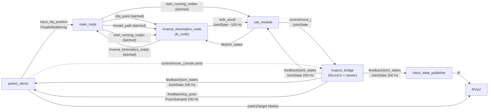
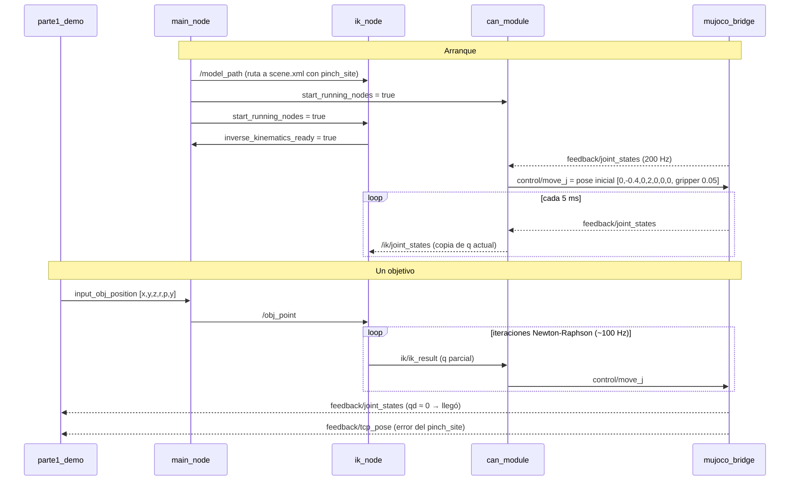

# Parte 1 — Brazo Nero en simulación moviéndose con ROS 2

> **Tarea:** mostrar el robot en simulación moviéndose usando la arquitectura de ROS 2, explicar cómo se realiza la comunicación (suscriptores y publicadores) y cómo se actualizan los datos de la simulación.

Nota: la zona de trabajo del brazo está en **x negativo (−x)**. En la pose inicial la pinza apunta hacia −x, y todos los objetivos de la demo están en esa zona.

---

## 1. Cómo ejecutarlo

Primero hay que compilar el workspace (ver el `README.md` principal para las dependencias):

```bash
cd ~/Nero_ws
colcon build --packages-select agx_arm_description nero_ctrl   # o colcon build completo
source install/setup.bash
```

> Los modelos MuJoCo del Nero ya vienen en el repo (`src/mujoco/agilex_arm/agilex_nero/` y `src/models_for_simulation/agilex_nero/`), con sus mallas en `assets/`. **No hace falta `mujoco_menagerie`.**

### Opción A

```bash
ros2 launch nero_ctrl nero_sim_ik.launch.py demo:=true
```

Esto levanta el simulador MuJoCo + RViz, `main_node`, `can_module`, `ik_node` y `parte1_demo`. La demo recorre 9 objetivos cartesianos: primero con la pinza horizontal a la izquierda y derecha, después con la pinza apuntando hacia abajo. En cada objetivo espera a que el brazo se detenga y muestra en el log el error final del `pinch_site`.

Variantes:

```bash
ros2 launch nero_ctrl nero_sim_ik.launch.py demo:=true demo_mode:=joint  # move_j directo (sin IK) + abre/cierra el gripper
ros2 launch nero_ctrl nero_sim_ik.launch.py                              # solo la arquitectura, sin demo
ros2 launch nero_ctrl nero_sim_ik.launch.py demo:=true rviz:=false
```


### Comandos para mostrar la comunicación en el video o informe

```bash
ros2 node list
ros2 topic list
rqt_graph                                    # grafo de nodos y tópicos (desmarcar "Hide debug")
ros2 node info /inverse_kinematics_node      # sus publicadores y suscriptores
ros2 topic info /control/move_j -v           # quién publica y quién escucha, con su QoS
ros2 topic hz /feedback/joint_states         # aprox. 200 Hz (feedback del simulador)
ros2 topic echo /ik/ik_result                # el stream de soluciones de la IK
ros2 topic echo /feedback/tcp_pose
```

En RViz se puede agregar un display **Marker** en el tópico `/parte1/target` para ver una esfera roja en el objetivo actual de la demo.

---

## 2. Arquitectura: nodos, tópicos y mensajes



### Tabla de publicadores y suscriptores

| Nodo | Publica | Se suscribe a |
|---|---|---|
| **mujoco_bridge** (`agx_arm_description/scripts/mujoco_viewer.py`) | `feedback/joint_states` (JointState, 200 Hz), `feedback/tcp_pose` (PoseStamped, 200 Hz) | `control/move_j`, `control/joint_states`, `control/move_p`, `control/move_l`, `control/move_c` |
| **robot_state_publisher** | `/tf`, `/robot_description` | `feedback/joint_states` (remapeado desde `joint_states`) |
| **main_node** | `/model_path` (String, latched), `start_running_nodes` (Bool, latched), `/obj_point` (Float64MultiArray, latched) | `input_obj_position`, `mujoco_ready`, `controller_ready`, `inverse_kinematics_ready`, `can_ready` |
| **can_module** | `control/move_j` (pose inicial + reenvío de la IK), `/ik/joint_states`, `/start_running_nodes`, (`control/move_p/l/c/js` declarados) | `start_running_nodes`, `feedback/joint_states`, `ik/ik_result`, `test_pos` |
| **inverse_kinematics_node** (`nero_ctrl/IK_node.py`) | `inverse_kinematics_ready` (Bool, latched), `ik/ik_result` (JointState) | `start_running_nodes`, `ik/joint_states`, `/obj_point`, `/model_path`, `init_vel_robot` |
| **parte1_demo** (nuevo) | `input_obj_position` (modo ik), `control/move_j` (modo joint), `parte1/target` (Marker) | `feedback/joint_states`, `feedback/tcp_pose`, `inverse_kinematics_ready` |

**QoS.** Las señales de arranque y configuración (`/model_path`, `start_running_nodes`, `inverse_kinematics_ready`, `/obj_point` y la pose inicial en `control/move_j`) usan `DurabilityPolicy.TRANSIENT_LOCAL` (*latched*): el último mensaje queda guardado y le llega a un suscriptor aunque este se conecte después. Por eso el orden de arranque de los nodos no importa. Los flujos continuos (`feedback/joint_states`, `ik/joint_states`, `ik/ik_result`) son `VOLATILE`, porque solo interesa el dato más reciente.

**Mismo código en simulación y en el robot real.** `mujoco_bridge` imita la interfaz de `agx_arm_ctrl` (el driver CAN del brazo real): escucha `control/move_j` y publica `feedback/joint_states`. Así, `main_node`, `can_module` e `ik_node` no cambian entre `mode:=sim` y `mode:=real`. Lo único que cambia es quién está al otro lado de esos dos tópicos.

---

## 3. Flujo de un movimiento (modo IK)



1. **parte1_demo** publica el objetivo `[x, y, z, roll, pitch, yaw]` en `input_obj_position`.
2. **main_node** lo reenvía sin cambios a `/obj_point` (latched).
3. **ik_node** recibe el objetivo y lo deja a un hilo de trabajo (`ik_worker`, con `threading.Condition`), para no bloquear el callback de ROS. Ese hilo resuelve la IK con Newton-Raphson y la pseudoinversa del Jacobiano de cuerpo, usando su **propia copia** del modelo MuJoCo (`models_for_simulation/agilex_nero/scene.xml`, que tiene el sitio `pinch_site`). Esa copia solo se usa para cinemática (`mj_forward`, `mj_jacSite`): no simula física.
4. En **cada iteración** de la IK (paso `alpha = 0.2`, limitado a 0.05 en el espacio cartesiano y 0.1 rad en el articular) publica la solución parcial en `ik/ik_result`, con un `sleep(0.01)`. Esto produce un *stream* de unos 100 Hz que lleva el brazo poco a poco por el camino de convergencia, en vez de un salto.
5. **can_module** reenvía cada `ik/ik_result` a `control/move_j`.
6. **mujoco_bridge** actualiza su objetivo articular y el brazo se mueve en el simulador (ver la sección 4).
7. El simulador publica `feedback/joint_states` a 200 Hz. **can_module** lo copia a `/ik/joint_states`, e **ik_node** actualiza su `current_q` y su modelo interno (`qpos`, `qvel`, `mj_forward`). Así, la siguiente IK parte del estado real del brazo.
8. **parte1_demo** mira las velocidades articulares de `feedback/joint_states`. Cuando `max|q̇| < 0.02 rad/s` durante 0.8 s, considera que el brazo llegó, calcula la posición del `pinch_site` a partir de `feedback/tcp_pose` (pose de `link7` + offset `(0.1733, 0, −0.0235)`) y pasa al siguiente objetivo.

En **modo joint**, `parte1_demo` publica directamente en `control/move_j` (7 articulaciones + `gripper` en metros de apertura) y se salta los pasos 2 a 5.

---

## 4. Cómo se actualizan los datos de la simulación

El nodo `mujoco_bridge` (`mujoco_viewer.py`) corre en **dos hilos** que comparten `MjModel` y `MjData`, protegidos por un `threading.Lock` (`_data_lock`):

**Hilo ROS (`rclpy.spin` en un hilo aparte).** Ejecuta los callbacks y el timer:
- `_on_move_j(msg)`: recorta cada articulación a su rango y guarda el **objetivo** `self._jgoal`. Si llega `gripper`, escribe directo `data.ctrl[gripper] = ancho/2`, porque el actuador mueve un dedo y el otro lo sigue por una restricción `equality`. No mueve el brazo directamente: solo cambia la referencia.
- `move_p / move_l / move_c`: calculan la IK de la trayectoria completa y la guardan en `self._traj` (perfil *minimum-jerk*).
- Timer a 200 Hz `_publish_feedback()`: lee `data.qpos` y `data.qvel` y publica `feedback/joint_states` (`joint1..7`, `gripper` = 2·`gripper_joint1`, y después los joints propios de MuJoCo). Calcula la pose de `link7` en el marco `base_link` y la publica en `feedback/tcp_pose`.

**Hilo principal (bucle de física + viewer).**

```text
while viewer.is_running():
    bridge.step():            # con _data_lock
        _advance_trajectory() #   si hay _traj: interpola la trayectoria
                              #   si no: _follow_joint_goal(): acerca data.ctrl a _jgoal
                              #          con un filtro exponencial (τ = 0.1 s) y velocidad
                              #          máxima joint_speed = 0.8 rad/s
        mujoco.mj_step(model, data)   # avanza la física un timestep (0.002 s → 500 Hz)
    viewer.sync()  (~60 Hz)           # refresca la ventana
    sleep(...)                        # mantiene el tiempo simulado = tiempo real
```

- `data.ctrl` es la **referencia** de los actuadores `position` del MJCF (controladores PD internos: `kp = 80/80/80/40/10/10/10`, más `kv`). `mj_step` integra la dinámica (integrador `implicitfast`) y actualiza `qpos` y `qvel`. Esos son los valores que lee el timer de feedback.
- La gravedad se anula (`model.opt.gravity = 0`) para imitar la compensación de gravedad que hace el brazo real. Sin eso, con los `kp` bajos el brazo quedaría unos 5 cm por debajo de lo ordenado. Esto se desactiva con `--no-gravcomp`.
- El ritmo se ajusta con el reloj: si la simulación va adelantada, duerme; si se atrasa más de 0.5 s, se resincroniza.

En resumen, **los mensajes ROS solo cambian referencias** (`_jgoal`, `_traj`, `ctrl` del gripper), el **bucle de física** las convierte en movimiento con `mj_step`, y el **timer de feedback** publica el estado resultante a 200 Hz. Con ese estado se cierra el lazo: `can_module` lo reenvía a la IK, `robot_state_publisher` lo pasa a `/tf` para RViz, y `parte1_demo` decide cuándo pasar al siguiente objetivo.

---

## 5. Archivos agregados en esta parte

| Archivo | Qué hace |
|---|---|
| `src/nero_ctrl/nero_ctrl/parte1_demo.py` | Nodo demo (modos `ik` y `joint`). Recorre waypoints en −x y espera a que el brazo se detenga usando el feedback. |
| `src/nero_ctrl/launch/nero_sim_ik.launch.py` | Simulador + `main_node` + `can_module` + `ik_node` (+ demo opcional) con un comando. |
| `src/nero_ctrl/setup.py`, `package.xml` | Entry point `parte1_demo` y dependencia `visualization_msgs`. |
| `docs/Parte1_arquitectura_ROS2.md` | Este documento. |

### Verificación

Los waypoints cartesianos se verificaron offline con el mismo algoritmo de `IK_node.py` sobre el modelo `models_for_simulation/agilex_nero/scene.xml`: todos convergen a menos de 1 mm. También se corrió el flujo completo (`mujoco_bridge` + `main_node` + `can_module` + `ik_node` + `parte1_demo`) sin ventana: los 9 objetivos se alcanzan con un error del `pinch_site` de 1 a 5 mm, que es el error estacionario de los actuadores de posición de MuJoCo.

Orientaciones útiles del `pinch_site` (convención `R = Rz·Ry·Rx`, igual que `ik_node`):

| Orientación | roll, pitch, yaw |
|---|---|
| Pinza horizontal apuntando a −x (pose inicial) | `-1.5708, 0.0, 3.1416` |
| Pinza vertical apuntando hacia abajo (−z), útil para agarrar en las Partes 2 y 3 | `0.0, 1.5708, -1.5708` |
