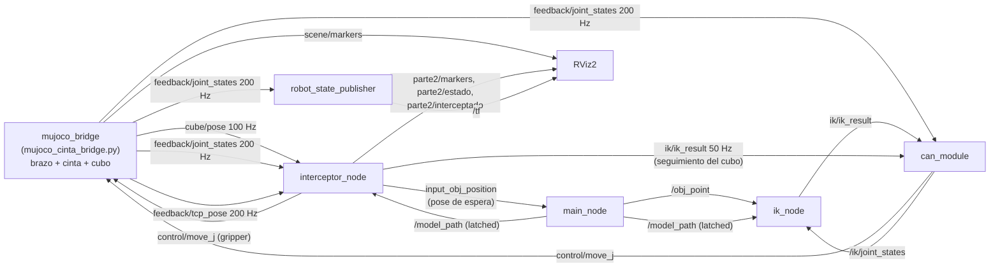

# Parte 2: cubo sobre la cinta transportadora e intercepción

> **Tarea:** agregar un cubo de 4 cm que se mueve a velocidad constante en línea recta frente al robot, y lograr que el brazo intercepte al cubo en algún punto de su trayectoria.

Esta parte usa la cinta que modeló el grupo (`cinta.xml`) y la misma forma de montarla que el notebook `Código 1.ipynb`: se pega con `MjSpec.attach` en x = −0.45 m, girada 90°. La diferencia es que ahora todo corre dentro de la arquitectura de ROS 2.

---

## 1. Cómo ejecutarlo

```bash
cd ~/Tarea_nero
colcon build --packages-select agx_arm_description nero_ctrl
source install/setup.bash

ros2 launch nero_ctrl parte2.launch.py
```

Al lanzar se abren MuJoCo y RViz. Unos 8 s después el cubo empieza a avanzar por la cinta. El brazo abre la pinza y espera sobre la cinta; cuando el cubo entra a la zona alcanzable, se alinea encima de él, baja siguiéndolo y lo acompaña con los dedos a ambos lados. Después sube y espera la siguiente vuelta del cubo, porque el cubo vuelve al inicio cada vez que llega al final de la banda.

En la terminal se ve una línea como esta:

```
[interceptor_node] *** INTERCEPTADO #1: cubo en [-0.45, -0.021, 0.084], pinch_site en [-0.447, -0.025, 0.085] (error 7.4 mm; xy 5.0 mm) ***
```

### Variantes

```bash
ros2 launch nero_ctrl parte2.launch.py cube_speed:=0.06        # más rápido (m/s)
ros2 launch nero_ctrl parte2.launch.py cube_dir:=1             # el cubo va de −y a +y
ros2 launch nero_ctrl parte2.launch.py interceptor:=false      # solo la escena: el cubo se mueve y el brazo no
ros2 launch nero_ctrl parte2.launch.py tracking:=ik_node       # seguir al cubo con ik_node (para comparar, ver 4.3)
ros2 launch nero_ctrl parte2.launch.py rviz:=false
```

### Comandos útiles en otra terminal

```bash
ros2 topic echo /cube/pose                 # posición del cubo (100 Hz)
ros2 topic echo /cube/twist                # velocidad real del cubo (referencia)
ros2 topic echo /parte2/estado             # estado de la máquina de estados
ros2 topic echo /parte2/interceptado       # true mientras el brazo acompaña al cubo
ros2 topic pub --once /conveyor/speed std_msgs/msg/Float64 "{data: 0.05}"   # cambiar la velocidad
ros2 topic pub --once /cube/reset std_msgs/msg/Empty "{}"                    # devolver el cubo al inicio
rqt_graph
```

En RViz aparecen dos MarkerArray nuevos: la cinta y el cubo (`/scene/markers`), y la trayectoria predicha en azul junto con el punto de intercepción en verde (`/parte2/markers`).

---

## 2. Arquitectura



### Nodos y tópicos nuevos

| Nodo | Publica | Se suscribe a |
|---|---|---|
| **mujoco_bridge** (`mujoco_cinta_bridge.py`, nuevo) | Todo lo de antes, más `cube/pose` (PoseStamped, 100 Hz), `cube/twist` (TwistStamped, 100 Hz) y `scene/markers` (MarkerArray, 10 Hz) | Todo lo de antes, más `conveyor/speed` (Float64) y `cube/reset` (Empty) |
| **interceptor_node** (nuevo) | `input_obj_position`, `ik/ik_result`, `control/move_j` (solo `gripper`), `parte2/estado` (String, latched), `parte2/interceptado` (Bool, latched), `parte2/markers` (MarkerArray) | `cube/pose`, `feedback/joint_states`, `feedback/tcp_pose`, `inverse_kinematics_ready`, `/model_path` |

`main_node`, `can_module` e `ik_node` **no se modificaron**.

---

## 3. Simulación: cinta y cubo (`mujoco_cinta_bridge.py`)

Es una **subclase** de `MujocoBridge` (`mujoco_viewer.py`). El brazo se comanda y publica su estado exactamente igual que antes; solo se agrega lo nuevo.

1. **Composición de la escena con MjSpec.** Es lo mismo que hace el notebook del grupo:
   - Se carga `scene_nero_arm.xml`.
   - Se pega `cinta.xml` con el prefijo `cinta_` en `pos = (−0.45, 0, 0)` y `yaw = 1.5708`, de modo que la banda queda a lo largo del eje y, frente al robot.
   - Se agrega el cuerpo `cubo` (caja de 4 cm, 50 g) con un `freejoint`.
   - Se eliminan los keyframes de `nero_arm.xml`, porque tienen el tamaño de `qpos` sin el cubo y no compilarían.
2. **Gravedad.** El bridge original ponía la gravedad del mundo en 0 para imitar la compensación de gravedad del brazo real, pero así el cubo flotaría. Ahora la gravedad es real (−9.81) y el brazo usa `body.gravcomp = 1` en cada uno de sus cuerpos. Para el brazo el efecto es el mismo, y el cubo sí pesa, lo que va a importar en la Parte 3 al levantarlo.
3. **Movimiento a velocidad constante.** En cada paso de física (500 Hz), después de `mj_step`:
   - Se avanza `s += v·dt` a lo largo del eje de la banda.
   - Se imponen la posición y la velocidad del cubo en el plano de la banda (coordenada a lo largo y lateral).
   - La altura la resuelve la física: el cubo se apoya en la banda.

   Es un movimiento **cinemático**, porque así la velocidad es exactamente constante. Si en cambio se arrastrara el cubo por fricción contra una banda fija, la fricción lo frenaría en cada paso (μ·g·dt ≈ 2 cm/s por paso) y la velocidad no sería constante. Los valores de la geometría (centro, eje, largo y altura de `cinta_banda_superior`) se leen del modelo, así que si el grupo cambia `cinta.xml` todo se ajusta solo.
4. **Fin de la banda.** Cuando el cubo llega al final vuelve al inicio, espera 1 s y sigue (`--no-loop` lo desactiva). Si el cubo deja de estar sobre la banda o lo tocan **los dos dedos** de la pinza, la cinta deja de imponerle el movimiento. Eso queda listo para la Parte 3.
5. **Publicación.** La pose y la velocidad del cubo se publican en el marco `base_link`. Funcionan como un sensor "perfecto"; en la Parte 4 se puede reemplazar o complementar con el sensor de distancia.

Parámetros del script (los pasa `parte2.launch.py` a través de `viewer_args`): `--cinta-pos`, `--cinta-yaw`, `--cube-size`, `--cube-mass`, `--cube-speed`, `--cube-dir`, `--cube-lateral`, `--cube-start-delay`, `--no-loop`.

---

## 4. Intercepción (`interceptor_node.py`)

### 4.1 Estimación de la trayectoria

El nodo **no usa** la velocidad real (`cube/twist`). La estima a partir de `cube/pose`, con un ajuste lineal por mínimos cuadrados `p(t) = p₀ + v·(t − t_ref)` sobre el último segundo de muestras. Con eso predice dónde va a estar el cubo en cualquier instante futuro. Si el cubo salta más de 3 cm entre dos muestras (porque la cinta lo devolvió al inicio), se borra la historia.

### 4.2 Por qué el brazo "acompaña" al cubo y no lo espera quieto

Con la pinza vertical, rpy = (0, π/2, −π/2), **los dedos abren a lo largo del eje y**, que es justo la dirección de la cinta. Si la pinza esperara quieta a la altura del cubo, el cubo chocaría con el dedo que tiene delante. Se probó girar la pinza 90° para que los dedos quedaran a lo largo de x, pero casi no hay solución de IK en la zona de la cinta, por los límites de `joint6` (−0.73 a 0.95) y `joint7` (±π/2).

Por eso la intercepción consiste en **igualar posición y velocidad**: la pinza se pone encima del cubo, baja mientras lo sigue y queda con un dedo delante y otro detrás. Así, en la Parte 3 basta con cerrar la pinza en ese momento.

### 4.3 Dos IK: la del curso y una de seguimiento

| Movimiento | IK usada | Camino |
|---|---|---|
| Ir a la pose de espera sobre la cinta (objetivo fijo) | `ik_node`, la del curso | `input_obj_position → main_node → /obj_point → ik_node → ik/ik_result → can_module → control/move_j` |
| Seguir al cubo (objetivo en movimiento) | `tracking_ik.py` (nuevo), a 50 Hz | `interceptor_node → ik/ik_result → can_module → control/move_j` |

**`ik_node` no sirve para seguir un objetivo que se mueve.** Cada cálculo parte del estado *medido* del brazo, que va atrasado, y publica cada iteración. Por eso cada objetivo nuevo "tira" el comando hacia atrás. En simulación, el brazo seguía al cubo a la mitad de su velocidad y el error crecía a más de 7 cm, así que la alineación fallaba siempre. Se puede ver con `tracking:=ik_node`.

`tracking_ik.py` usa el mismo modelo (`/model_path`), el mismo `pinch_site` y la misma idea (Jacobiano del sitio más el error de posición y orientación), con tres diferencias:

- parte de la **última solución** y no del feedback;
- usa mínimos cuadrados amortiguados;
- hace pocas iteraciones por llamada.

Publica en el **mismo tópico que `ik_node`** (`ik/ik_result`), así que `can_module` y el simulador no cambian.

Además hay una **corrección integral en x‑y** (`ki = 1.5 1/s`) que compara el objetivo con la posición real del `pinch_site` (calculada desde `feedback/tcp_pose`). Compensa el error estacionario de la muñeca, que en el MJCF tiene `kp = 10` y `frictionloss = 1`, lo que equivale a una zona muerta de unos 0.1 rad; sin la corrección, la pinza quedaba 1 a 1.5 cm corrida en x. También se usa un adelanto `lead = 0.15 s` sobre la predicción para compensar el retraso del seguidor articular del simulador.

### 4.4 Máquina de estados

```mermaid
stateDiagram-v2
    [*] --> INICIO
    INICIO --> ABRIENDO: ik_node listo + feedback + modelo
    ABRIENDO --> ESPERA: pinza abierta (1 s) → pose de espera vía ik_node
    ESPERA --> ALINEANDO: cubo en movimiento y la maniobra completa cabe en la ventana y∈[−0.22, 0.22]
    ALINEANDO --> BAJANDO: error xy < 12 mm durante 0.4 s
    ALINEANDO --> SUBIENDO: timeout 5 s / cubo sale de la ventana
    BAJANDO --> INTERCEPTADO: llegó a la altura de agarre con error < 8 mm
    BAJANDO --> SUBIENDO: cubo sale de la ventana
    INTERCEPTADO --> SUBIENDO: después de acompañarlo t_hold = 2 s
    SUBIENDO --> ESPERA: vuelve a la pose de espera; espera la siguiente vuelta del cubo
```



Alturas del `pinch_site`, que está en la punta de los dedos:

| Fase | Altura del `pinch_site` | Referencia |
|---|---|---|
| Alineación | `z_above = 0.17 m` | Los dedos quedan por encima del cubo, cuya cara superior está a 0.104 m |
| Agarre | centro del cubo − 4 mm ≈ 0.080 m | Las puntas de los dedos quedan unos 1.2 cm sobre la banda, que está a 0.064 m |

### 4.5 Parámetros (`ros2 run nero_ctrl interceptor_node --ros-args -p ...`)

| Parámetro | Default | Qué hace |
|---|---|---|
| `tracking` | `interno` | `interno` (tracking_ik) o `ik_node` |
| `rpy` | `[0, π/2, −π/2]` | Orientación de la pinza (vertical) |
| `z_above` | 0.17 | Altura de alineación (m) |
| `grasp_dz` | −0.004 | Altura del pinch respecto al centro del cubo (m) |
| `lead` | 0.15 | Adelanto de la predicción (s) |
| `rate` | 50 | Hz de los objetivos de seguimiento |
| `t_descend`, `t_hold` | 2.0, 2.0 | Duración de la bajada y del acompañamiento (s) |
| `window_y_min`, `window_y_max` | −0.22, 0.22 | Zona de la cinta donde se intercepta (m) |
| `ki`, `corr_max` | 1.5, 0.025 | Corrección integral en x‑y |
| `standby_xyz` | [−0.45, 0, 0.17] | Pose de espera sobre la cinta |
| `loop` | true | Intentar en cada vuelta del cubo |

---

## 5. Resultados (simulación sin ventana del flujo completo)

Se corrió el flujo completo (`mujoco_cinta_bridge` + `main_node` + `can_module` + `ik_node` + `interceptor_node`) sin ventana, con un ROS simulado en un solo proceso, porque en el entorno donde se desarrolló no había ROS 2. Faltaría confirmarlo en Ubuntu 24.04 con Jazzy.

| Caso | Resultado |
|---|---|
| 0.04 m/s, sentido −y | 3 de 3 vueltas interceptadas. Error al interceptar de 7 a 8 mm (xy de unos 5 mm). Durante los 2 s de acompañamiento el error es de 5 a 7 mm en promedio y menos de 8 mm como máximo. |
| 0.06 m/s, sentido +y | Interceptado en las vueltas 2 y 3, con un error parecido. La primera vuelta se pierde porque el brazo todavía no llegaba a la pose de espera. |
| Contactos robot–cubo | 0: los dedos rodean al cubo sin tocarlo, con unos 1.8 cm de holgura por lado. |
| Velocidad del cubo | Exactamente 0.040 m/s, con la gravedad real y el brazo estable gracias a gravcomp. |
| `tracking:=ik_node` | La alineación falla porque el error crece a más de 7 cm. Por eso se usa la IK de seguimiento. |

---

## 6. Archivos de esta parte

| Archivo | Tipo | Qué cambia |
|---|---|---|
| `src/agx_arm_description/scripts/mujoco_cinta_bridge.py` | **nuevo** | Simulador con cinta y cubo (subclase de `MujocoBridge`) |
| `src/nero_ctrl/nero_ctrl/interceptor_node.py` | **nuevo** | Estimación, predicción y máquina de estados de la intercepción |
| `src/nero_ctrl/nero_ctrl/tracking_ik.py` | **nuevo** | IK rápida para objetivos en movimiento |
| `src/nero_ctrl/launch/parte2.launch.py` | **nuevo** | Lanza todo lo de la Parte 2 |
| `docs/Parte2_cinta_intercepcion.md` | **nuevo** | Este documento |
| `src/agx_arm_description/scripts/mujoco_viewer.py` | modificado (refactor sin cambio de comportamiento) | La carga del modelo pasa a un método `_load_model()` (para que la subclase componga la escena), y `main()` se separa en `build_arg_parser()` y `run_bridge()` (para que la subclase reutilice el bucle de física y viewer) |
| `src/agx_arm_description/launch/display_mujoco.launch.py` | modificado | Nuevo argumento `viewer_args`: argumentos extra para el script del simulador |
| `src/agx_arm_description/launch/bringup_nero.launch.py` | modificado | Pasa `viewer_script` y `viewer_args` a `display_mujoco` |
| `src/nero_ctrl/launch/nero_can_ctrl.launch.py` | modificado | Pasa `viewer_script` y `viewer_args` a `bringup_nero` (solo `mode:=sim`) |
| `src/agx_arm_description/rviz/default.rviz` | modificado | Dos displays MarkerArray: `/scene/markers` y `/parte2/markers` |
| `src/nero_ctrl/setup.py` | modificado | Entry point `interceptor_node` |
| `README.md` | modificado | Enlace a esta documentación |

Sin argumentos nuevos todo funciona como antes: la Parte 1 (`nero_sim_ik.launch.py`) y el `nero_can_ctrl.launch.py` del README siguen usando `mujoco_viewer.py` con la escena sin cinta. `cinta.xml` y el notebook del grupo no se tocaron.

### Limitaciones conocidas

- `interceptor_node` supone que la cinta va a lo largo del eje y (la ventana se define en y). Si se gira la cinta (`cinta_yaw`), hay que ajustar la ventana y la orientación de la pinza.
- El cubo se mueve de forma cinemática mientras está sobre la banda. Para la Parte 3 eso ya está resuelto: si lo tocan los dos dedos o lo levantan, deja de imponerse el movimiento.

La Parte 3 (cerrar la pinza y recoger el cubo) continúa desde el estado INTERCEPTADO: ver [`Parte3_agarrar_cubo.md`](Parte3_agarrar_cubo.md).
