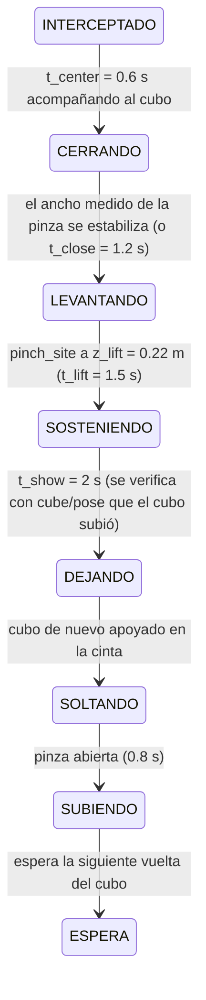

# Parte 3: cerrar la pinza y recoger el cubo

> **Tarea:** hacer que el brazo pueda cerrar el gripper y recoger el cubo.

Esta parte continúa la intercepción de la Parte 2 (ver [`Parte2_cinta_intercepcion.md`](Parte2_cinta_intercepcion.md)): una vez que la pinza rodea al cubo y se mueve con él, se cierra, levanta el cubo, lo muestra arriba y lo devuelve a la cinta para la siguiente vuelta.

## 1. Cómo ejecutarlo

```bash
ros2 launch nero_ctrl parte3.launch.py
# es lo mismo que:
ros2 launch nero_ctrl parte2.launch.py grasp:=true
```

En otra terminal:

```bash
ros2 topic echo /parte3/agarrado    # true mientras el cubo está levantado
ros2 topic echo /parte2/estado      # INTERCEPTADO → CERRANDO → LEVANTANDO → SOSTENIENDO → DEJANDO → SOLTANDO
ros2 topic echo /cube/pose          # se ve cómo sube la z del cubo (de 0.084 a unos 0.215 m)
```

En el log aparece:

```
[interceptor_node] Pinza cerrada: ancho medido 37.3 mm. Levantando el cubo.
[interceptor_node] *** CUBO RECOGIDO #1: cubo a z = 0.216 m (13.2 cm sobre la cinta), a 5.4 mm del pinch_site ***
```

## 2. Secuencia



1. **Cerrar sin soltar el seguimiento.** Mientras se cierra, la pinza sigue a la velocidad del cubo; si se detuviera, el cubo chocaría con el dedo de adelante. El ancho comandado viaja en el mismo mensaje de `ik/ik_result` que las articulaciones (`gripper`), y `can_module` lo reenvía a `control/move_j`.
2. **Detección del cierre.** El nodo lee el ancho real de la pinza desde `feedback/joint_states` (`gripper`). Cuando deja de cambiar (menos de 0.5 mm en los últimos 20 mensajes), los dedos ya apretaron el cubo, que tiene 40 mm: el ancho medido queda en unos 37 mm por la penetración del contacto.
3. **La cinta suelta al cubo.** En el simulador (`mujoco_cinta_bridge.py`), cuando el cubo toca los **dos dedos**, la cinta deja de imponerle el movimiento. Desde ahí el cubo es un cuerpo libre con gravedad real que sostiene la fricción de los dedos.
4. **Levantar y verificar.** Se sube a z = 0.22 m y, en vez de suponer que el agarre funcionó, se **verifica** con `cube/pose` que el cubo subió más de 5 cm. Si no subió, se avisa con un WARN.
5. **Devolver a la cinta (`place_back`).** Se baja el cubo en el mismo punto y se abre la pinza. El simulador detecta que el cubo volvió a quedar suelto sobre la banda y la cinta lo vuelve a mover. Así la demo se repite en cada vuelta del cubo.

## 3. Cambio en la pinza simulada

Con los valores originales del MJCF (`kp = 40`, `frictionloss = 1`), **la pinza no alcanzaba a apretar el cubo**. El dedo se detiene cuando `kp·error ≈ 1 N` y quedaba a 51 mm de apertura, sin tocar el cubo de 40 mm. Por eso `mujoco_cinta_bridge.py` sube la ganancia del actuador `gripper` a `kp = 300` y `kv = 10`, solo en la escena de las Partes 2 y 3. La fuerza sigue limitada a ±10 N por el `forcerange` del modelo. Se configura con `--gripper-kp` y `--gripper-kv`; con `--gripper-kp 0` se deja el valor original.

## 4. Parámetros nuevos de `interceptor_node`

| Parámetro | Default | Qué hace |
|---|---|---|
| `grasp` | false | `true` activa la Parte 3; con `false` queda la Parte 2 |
| `gripper_close` | 0.0 | Ancho comandado al cerrar (m) |
| `t_center` | 0.6 | Segundos acompañando al cubo antes de cerrar |
| `t_close` | 1.2 | Tiempo máximo cerrando |
| `z_lift` | 0.22 | Altura del pinch_site con el cubo levantado (m) |
| `t_lift` | 1.5 | Duración de la subida y de la bajada (s) |
| `t_show` | 2.0 | Segundos mostrando el cubo arriba |
| `place_back` | true | Devolver el cubo a la cinta; con `false` se suelta arriba y cae |

Tópico nuevo: `parte3/agarrado` (std_msgs/Bool, latched).

## 5. Resultados (simulación sin ventana del flujo completo)

| Vuelta | Intercepción | Ancho al cerrar | Cubo levantado |
|---|---|---|---|
| 1 | error 7.9 mm | 37.3 mm | z = 0.216 m (13.2 cm sobre la cinta), a 5.4 mm del pinch_site |
| 2 | error 7.8 mm | 37.7 mm | z = 0.215 m (13.1 cm sobre la cinta), a 4.9 mm del pinch_site |

En las dos vueltas el cubo volvió a la cinta y siguió su camino. La Parte 2 (`grasp:=false`) se comporta igual que antes: intercepta, lo acompaña sin tocarlo y no registra contactos entre el robot y el cubo.

## 6. Archivos

| Archivo | Cambio |
|---|---|
| `src/nero_ctrl/nero_ctrl/interceptor_node.py` | Estados CERRANDO, LEVANTANDO, SOSTENIENDO, DEJANDO y SOLTANDO; lectura del ancho de la pinza; tópico `parte3/agarrado` |
| `src/agx_arm_description/scripts/mujoco_cinta_bridge.py` | Ganancia de la pinza (`--gripper-kp`, `--gripper-kv`) |
| `src/nero_ctrl/launch/parte2.launch.py` | Nuevo argumento `grasp` |
| `src/nero_ctrl/launch/parte3.launch.py` | **nuevo**: `parte2.launch.py` con `grasp:=true` |
| `docs/Parte3_agarrar_cubo.md` | **nuevo**: este documento |
